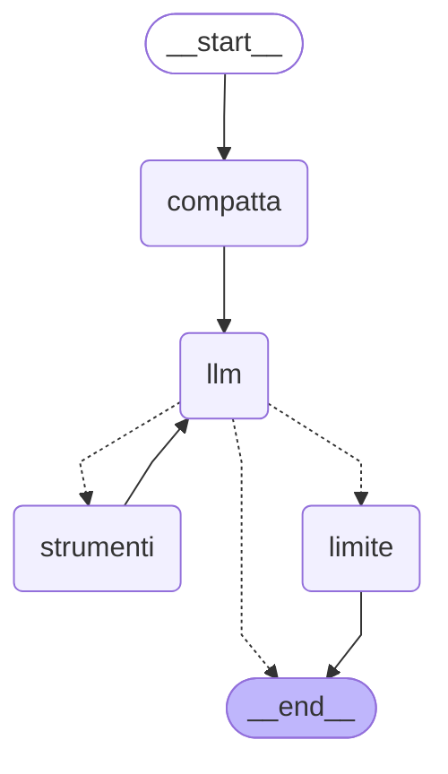

# Come funziona l'assistente

## Che cosa è stato fatto

- Una chat da terminale (`python -m agente`) che conversa con un modello locale servito da LM Studio
  tramite la sua API compatibile con OpenAI.
- Il flusso è un **grafo LangGraph esplicito**: stato, nodi e instradamento sono scritti a mano in
  `agente/graph.py`, senza componenti prefabbricati (`create_react_agent`, `ToolNode`).
- Uno **strumento orologio**, `ora_corrente`, che il modello richiede con il tool calling e che il
  programma esegue davvero. L'output indica sempre il fuso orario.
- Una **cronologia di sessione** tenuta dal client in una lista: si perde all'uscita. Quando diventa
  lunga, il nodo `compatta` fa riassumere al modello i messaggi vecchi.
- Due **server MCP** (lezione 5), `meteo` e `note`, avviati come sottoprocessi: i loro strumenti
  (`meteo_attuale`, `previsioni_meteo`, `aggiungi_nota`, `elenca_note`, `elimina_nota`) vengono
  scoperti dal catalogo e usati dal grafo come l'orologio. Le note sono salvate in SQLite e
  **persistono**; la cronologia della chat no.
- Avvio anche in **Docker Compose**, con LM Studio che resta sull'host.

## Che cosa fa l'agente, passo per passo

1. Il client legge la domanda (`Tu> ...`) e invoca il grafo con la cronologia più la nuova domanda.
2. Il nodo `compatta` controlla la lunghezza della cronologia: oltre `MAX_MESSAGGI_CONTESTO` messaggi
   fa riassumere al modello quelli vecchi e tiene solo il riassunto più gli ultimi `MESSAGGI_DA_TENERE`.
3. Il nodo `llm` manda al modello il prompt di sistema (con l'eventuale riassunto) e gli ultimi
   messaggi della cronologia.
4. Se il modello risponde con del testo, il turno finisce e il client stampa `Assistente> ...`.
5. Se il modello chiede uno strumento (una *tool_call*), il nodo `strumenti` lo esegue e aggiunge il
   risultato alla cronologia; poi si torna al nodo `llm`, che ora vede l'ora vera e risponde.
6. Se il modello continua a chiedere strumenti oltre `MAX_PASSI_STRUMENTO` volte, il nodo `limite`
   chiude il turno con un messaggio di scuse.
7. Il client salva la cronologia restituita dal grafo (già compattata) e ripropone il prompt.

## Moduli

```
main.py ──► config.py        variabili d'ambiente → Config (errori chiari, uscita 1)
   │──────► llm.py           ChatOpenAI verso LM Studio (con strumenti e riassuntore senza) + verifica
   │──────► strumenti.py     strumento ora_corrente
   │──────► mcp_ponte.py     avvia i server MCP e ne espone il catalogo come tool sincroni
   │──────► graph.py         stato, nodi, instradamento, compattazione, finestra di contesto
   └──────► client.py        ciclo della chat e cronologia
```

- `graph.py` non importa `llm.py`: modello e strumenti gli arrivano da fuori. Così i test usano un
  modello finto, e nelle prossime lezioni si potranno aggiungere strumenti senza toccare il grafo.
- I server MCP (`server_mcp/meteo.py`, `server_mcp/note.py`) sono **programmi a parte**, non moduli
  dell'agente: l'agente li avvia con `python -m server_mcp.meteo` e ci parla via stdin/stdout.
- `client.py` non sa nulla di LM Studio: conosce solo il grafo compilato e gli errori
  `openai.APIError` e `GraphRecursionError`, che trasforma in messaggi leggibili.

## Schema del grafo

```
                      ┌────────────────────────────────────────────┐
                      ▼                                            │
START ─► compatta ─► llm ─► instrada_dopo_llm ─┬─ nessuna tool_call ──────────► END
                                               ├─ tool_call e passi < MAX ─► strumenti
                                               └─ tool_call e passi ≥ MAX ─► limite ─► END
```

Lo stesso grafo in Mermaid, generato dal codice con `get_graph().draw_mermaid()` (le frecce
tratteggiate sono gli archi condizionali):



Per rigenerarlo (con una lambda al posto del modello: per disegnare il grafo non serve LM Studio):

```powershell
python -c "from langchain_core.runnables import RunnableLambda; from agente.graph import costruisci_grafo; from agente.strumenti import crea_ora_corrente; g = costruisci_grafo(RunnableLambda(lambda m: m), [crea_ora_corrente()], max_passi=3, max_messaggi_contesto=20, fuso_predefinito='Europe/Rome', riassuntore=RunnableLambda(lambda m: m)); print(g.get_graph().draw_mermaid())"
```

## Stato

```python
class AgentState(TypedDict):
    messages: Annotated[list[AnyMessage], add_messages]  # cronologia (Human/AI/Tool)
    passi_strumento: int                                   # giri di strumento nel turno corrente
```

- `messages` usa il reducer `add_messages`: ogni nodo restituisce solo i messaggi **nuovi**, che
  vengono accodati.
- `passi_strumento` non ha reducer: il valore restituito sostituisce il precedente. Il client lo
  riparte da 0 a ogni domanda.
- Il prompt di sistema **non** sta nello stato: il nodo `llm` lo mette in testa a ogni chiamata.

## Nodi e instradamento

| Nodo | Che cosa fa | Restituisce |
|---|---|---|
| `compatta` | se i messaggi sono più di `MAX_MESSAGGI_CONTESTO`, li divide in vecchi e recenti (`dividi_cronologia`, taglio su un `HumanMessage`), manda i vecchi come testo (`trascrivi`) al riassuntore senza strumenti e sostituisce la cronologia; log INFO | `{}` oppure `{"messages": [RemoveMessage(REMOVE_ALL_MESSAGES), riassunto, *recenti]}` |
| `llm` | invia `[prompt di sistema + riassunto] + finestra_contesto(messages)` al modello, che ha già lo strumento collegato (`bind_tools`) | `{"messages": [AIMessage]}` |
| `strumenti` | esegue **ogni** tool_call dell'ultimo messaggio; scrive un log INFO per ciascuna; uno strumento sconosciuto, argomenti sbagliati o argomenti che non sono JSON valido (le `invalid_tool_calls` di LangChain) diventano un testo d'errore, non un'eccezione | `{"messages": [ToolMessage, ...], "passi_strumento": passi + 1}` |
| `limite` | risponde «Non eseguito» a ogni tool_call rimasta in sospeso (altrimenti la cronologia non sarebbe valida per l'API) e aggiunge il messaggio per l'utente; log WARNING | `{"messages": [ToolMessage, ..., AIMessage]}` |

Le tool_call con argomenti non JSON contano come tool_call: l'API le rimanda al modello, quindi
devono ricevere anch'esse un `ToolMessage`, altrimenti la cronologia non sarebbe più valida.

`instrada_dopo_llm(stato, max_passi)` è una funzione pura: nessuna tool_call → `END`; tool_call con
`passi_strumento < max_passi` → `strumenti`; altrimenti → `limite`.

Come rete di sicurezza il client passa a `invoke()` un `recursion_limit` di `2 * MAX_PASSI_STRUMENTO + 5`.
Con il nodo `limite` non dovrebbe mai scattare; se scatta, il client mostra un errore leggibile.

## Lo strumento `ora_corrente`

- Firma vista dal modello: `ora_corrente(fuso_orario: str = "Europe/Rome")`. Il fuso predefinito
  viene da `FUSO_ORARIO_PREDEFINITO` ed è scritto sia nella descrizione sia nel default.
- Il fuso è un nome IANA, validato con `zoneinfo`. Il database dei fusi arriva dal pacchetto `tzdata`,
  perché né Windows né l'immagine `python:3.13-slim` lo includono.
- L'output è sempre esplicito sul fuso, anche quando si usa il predefinito:

  ```
  Fuso orario: Europe/Rome (CET, UTC+01:00)
  Data: martedì 3 novembre 2026
  Ora: 12:47:57
  ISO 8601: 2026-11-03T12:47:57+01:00
  ```
- Giorni e mesi in italiano vengono da tabelle nel codice, non dal `locale` di sistema.
- Con un fuso non valido (es. `"Roma"`) lo strumento restituisce al modello un messaggio d'errore e
  scrive un WARNING; il modello può riprovare entro il limite di passaggi.
- La logica pura è `calcola_ora(fuso, adesso)`: i test le passano un istante fisso.

Nelle prove reali `google/gemma-4-e2b` chiama `ora_corrente` con `{}` per «Che ore sono?» (quindi
vale il default `Europe/Rome`) e con `{'fuso_orario': 'Asia/Tokyo'}` per «E a Tokyo?».

## Strumenti MCP: host, client e server

MCP (Model Context Protocol) è un protocollo per offrire strumenti a un modello senza scriverli
dentro l'agente. Tre ruoli:

| Ruolo | Chi è qui | Che cosa fa |
|---|---|---|
| **host** | l'applicazione `python -m agente` (grafo + modello) | decide quali server usare e porta le richieste del modello |
| **client** | l'oggetto `fastmcp.Client` dentro `agente/mcp_ponte.py` | una sessione con **un** server: chiede il catalogo, invia le chiamate |
| **server** | `server_mcp/meteo.py`, `server_mcp/note.py` | processi separati che dichiarano i tool e li eseguono |

Il trasporto è **stdio**: il client lancia il server come sottoprocesso (`sys.executable -m
server_mcp.meteo`, con `cwd` la cartella `lab_llm/`) e scambia messaggi JSON-RPC su stdin/stdout. Per
questo i server non scrivono mai su stdout (sarebbe corrompere il protocollo): i loro log vanno su
stderr.

### Il percorso di uno strumento

```
avvio      tools/list  ──► catalogo (nome, descrizione, schema JSON dei parametri)
                          └► un StructuredTool LangChain per voce, con schema = quello del server
costruzione  bind_tools(strumenti) ──► il modello conosce nome, descrizione e schema
domanda      il modello risponde con una tool_call {name, args, id}
esecuzione   nodo strumenti ──► tool.invoke(args) ──► tools/call (JSON-RPC) ──► il server esegue
risposta     testo del risultato ──► ToolMessage(content=testo, tool_call_id=id) ──► torna al nodo llm
```

- `tools/list` è la **discovery**: nome, descrizione e schema dei tool arrivano **solo** dal server
  (`list_tools()`), mai scritti nell'agente. Aggiungere un tool a un server lo rende disponibile
  senza toccare il grafo.
- `langchain-mcp-adapters`, che fa questo lavoro, **non è usato**: richiede `mcp<2`, incompatibile
  con `mcp==2.3.0` (richiesta da `fastmcp==4.1.6`). Il piccolo adattatore è `ConnessioneMCP._crea_strumento`.
- Lo schema è passato a LangChain come dizionario JSON e **non viene validato** lì: gli argomenti
  scelti dal modello arrivano al server, che li valida. Un argomento sbagliato diventa un testo
  d'errore, non un'eccezione che rompe il turno.
- Il nodo `strumenti` del grafo non sa che un tool è MCP: lo invoca come l'orologio. L'unica
  differenza visibile è `origine=mcp:<server>` nel log (nel campo `metadata` del tool).

### `tool_call_id` e ID JSON-RPC

Sono due identificativi diversi, su due «cavi» diversi:

| | `tool_call_id` | ID JSON-RPC |
|---|---|---|
| tra chi | modello ↔ cronologia della conversazione | client ↔ server MCP |
| chi lo crea | il modello (in LM Studio) | la libreria client, a ogni richiesta |
| a che serve | abbinare il `ToolMessage` alla `tool_call` che risponde | abbinare la risposta JSON-RPC alla sua richiesta |
| dove si vede | nei log (`call_id=...`) | non si vede: lo gestisce la libreria |

Il server MCP non conosce mai il `tool_call_id`, e il modello non vede mai l'ID JSON-RPC.

### Perché il ponte ha un thread

Il grafo e il client della chat sono **sincroni**; la libreria MCP è **asincrona** e una sessione con un
server deve restare aperta per tutta la chat (riavviare un sottoprocesso a ogni domanda sarebbe lento
e perderebbe lo stato). `ConnessioneMCP` risolve così:

1. all'ingresso (`with ConnessioneMCP(...)`) crea un **event loop asyncio** e lo fa girare in un
   **thread dedicato** (`ponte-mcp`), l'unico posto del programma con `asyncio`;
2. per ogni server, una coroutine «custode» apre la sessione, legge il catalogo e poi aspetta un
   evento di chiusura: la sessione si apre e si chiude nello stesso task, come richiede `anyio`;
3. ogni tool sincrono invia `call_tool` al loop con `run_coroutine_threadsafe` e attende l'esito
   (`futuro.result(timeout)`): per il grafo è una normale chiamata bloccante;
4. all'uscita segnala la chiusura ai custodi, attende che i sottoprocessi terminino, ferma il loop e
   unisce il thread.

### I tre esiti che il modello legge

| Situazione | Testo nel `ToolMessage` | Livello del log |
|---|---|---|
| successo | il testo restituito dal server | INFO, `esito=ok` |
| il server ha rifiutato la richiesta (`ToolError`: argomenti non validi, ID inesistente, città non trovata) | `Errore dallo strumento <nome>: <messaggio>` | WARNING + INFO `esito=errore` |
| il collegamento è fallito (timeout, processo morto) | `Errore di collegamento MCP con il server <server>: <dettaglio>` | WARNING + INFO `esito=errore` |

Distinguerli serve a capire dove cercare: nel secondo caso il server funziona e la richiesta era
sbagliata; nel terzo è il collegamento a non funzionare.

Se un server non parte o non risponde al catalogo entro `MCP_TIMEOUT`, `ConnessioneMCP` scrive un
WARNING e **prosegue**: gli altri strumenti restano disponibili e la chat si avvia. Anche per i
timeout vale `MCP_TIMEOUT` (per il server meteo, `METEO_TIMEOUT` vale per ogni richiesta HTTP).
La variabile `FASTMCP_LOG_LEVEL=WARNING`, passata ai sottoprocessi, tace il banner del framework.

### I due server

- **meteo** (`server_mcp/meteo.py`): `meteo_attuale(citta)` e `previsioni_meteo(citta, giorni=3)`,
  1–7 giorni. Chiama l'API di geocoding e poi quella delle previsioni di Open-Meteo (con `httpx`);
  indica sempre la località scelta (regione e paese, se noti), elenca le alternative con lo stesso
  nome, scrive «n.d.» per i valori mancanti e traduce i codici WMO in italiano.
- **note** (`server_mcp/note.py`): `aggiungi_nota(testo)`, `elenca_note(limite=10)`,
  `elimina_nota(id_nota)`. Archivio SQLite nel file `NOTE_DB`; query parametrizzate (un testo come
  `l'esame; DROP TABLE note` viene salvato letteralmente). `aggiungi_nota` ed `elimina_nota` modificano
  i dati e lo dichiarano nella loro descrizione.
- In entrambi la logica sta in funzioni e classi che non dipendono da MCP (`testo_meteo_attuale`,
  `ArchivioNote`), così si testano senza avviare nulla; il decoratore `@mcp.tool` le espone soltanto.

### Che cosa fa il prompt di sistema

Con un modello piccolo la descrizione del tool non basta: `PROMPT_SISTEMA` dice di usare
`meteo_attuale` e `previsioni_meteo` per il meteo, di **chiamare** `aggiungi_nota` quando l'utente
chiede di ricordare qualcosa e di non dire mai «salvata» se lo strumento non l'ha confermato, e di
riferire gli errori senza inventare risultati. Senza quella riga `google/gemma-4-e2b` rispondeva
«Ho salvato la nota» senza chiamare nulla.

## Compattazione della cronologia (nodo `compatta`)

- Scatta all'inizio del turno quando la cronologia supera `MAX_MESSAGGI_CONTESTO` (default 20).
- Restano gli ultimi `MESSAGGI_DA_TENERE` messaggi (default 6), con l'inizio spostato in avanti fino
  a un `HumanMessage`: una tool_call non viene mai separata dalla sua risposta.
- I messaggi vecchi diventano un testo semplice (`Utente: ...`, `Assistente: ...`, `Strumento: ...`,
  `Riassunto precedente: ...`) e vanno a un **riassuntore**: lo stesso modello ma **senza strumenti**
  (`crea_riassuntore`), così non può chiedere l'ora invece di riassumere.
- Il riassunto diventa un `SystemMessage` con `name="riassunto"` in testa alla cronologia. Per
  sostituire la cronologia il nodo restituisce `RemoveMessage(id=REMOVE_ALL_MESSAGES)` seguito dai
  messaggi da tenere: è il modo previsto da LangGraph per riscrivere una lista con `add_messages`.
- Alla compattazione successiva il riassunto vecchio entra nel testo da riassumere: ce n'è sempre uno solo.
- Il nodo `llm` unisce il riassunto al prompt di sistema: un solo messaggio di sistema in testa, perché
  alcuni modelli non ne accettano altri.
- Se LM Studio non risponde (`openai.APIError`) o il riassunto è vuoto: log WARNING, cronologia
  lasciata intera; resta la finestra scorrevole qui sotto.
- Prova reale: dopo cinque domande con soglia 6, `google/gemma-4-e2b` risponde ancora a «Come mi
  chiamo?» grazie al riassunto. Il prompt del riassunto chiede di scrivere «l'utente si chiama ...»:
  con un generico «Gabriele studia a Udine» il modello non capiva che si parlava di chi scrive.

## Contesto inviato al modello

- Al modello arrivano al massimo gli ultimi `MAX_MESSAGGI_CONTESTO` messaggi (default 20), tramite
  `finestra_contesto(messaggi, n)`. Con la compattazione attiva serve come rete di sicurezza.
- La finestra parte sempre da un `HumanMessage`: così non comincia mai con un `ToolMessage` orfano o
  con una tool_call senza risposta.
- Se l'ultimo turno da solo supera `n`, si tiene comunque tutto dall'ultimo `HumanMessage` in poi.
- Quando la finestra taglia qualcosa compare un log DEBUG («contesto: inviati 20 di 34 messaggi»):
  si vede con `LOG_LEVEL=DEBUG`.

## Log e print didattici

I log vanno su **stderr** (la chat su stdout), con il formato
`2026-11-03 12:47:57 INFO  agente.graph | ...`. Il livello viene da `LOG_LEVEL`. Le librerie HTTP
(`httpx`, `httpx2`, `httpcore`, `openai`) sono forzate a WARNING, altrimenti ogni richiesta verrebbe
stampata.

| Evento | Livello | Esempio |
|---|---|---|
| avvio | INFO | `avvio: modello=google/gemma-4-e2b server=http://localhost:1234/v1 max_passi=3 contesto=20 da_tenere=6` |
| cronologia compattata | INFO | `compattati 16 messaggi, tenuti 5` |
| riassunto non riuscito | WARNING | `riassunto non riuscito, cronologia lasciata intera: Connection error.` |
| chiamata a uno strumento | INFO | `strumento=ora_corrente origine=locale call_id=... argomenti={"fuso_orario": "Asia/Tokyo"} esito=ok risultato=Fuso orario: Asia/Tokyo ...` |
| chiamata a un tool MCP | INFO | `strumento=meteo_attuale origine=mcp:meteo call_id=... argomenti={"citta": "Udine"} esito=ok risultato=...` |
| catalogo di un server MCP | INFO | `server MCP meteo: catalogo [meteo_attuale, previsioni_meteo]` |
| server MCP non disponibile, errore di collegamento | WARNING | `server MCP meteo non disponibile: ...` |
| fuso non valido, strumento sconosciuto | WARNING | `strumento ora_corrente: fuso 'Roma' non riconosciuto` |
| limite raggiunto | WARNING | `limite di 3 passaggi raggiunto: 1 tool_call non eseguite` |
| finestra di contesto applicata | DEBUG | `contesto: inviati 20 di 34 messaggi` |
| errore di collegamento | ERROR | `LM Studio non raggiungibile su ...: Connection error.` |

Nel codice ci sono anche dei **print didattici** `# print("[passo] ...")`, all'ingresso di ogni nodo,
a ogni decisione di instradamento, prima di ogni chiamata al modello e a ogni turno del client. Sono
commentati per non sporcare la chat: per seguire il flusso passo per passo basta togliere il `#`.
