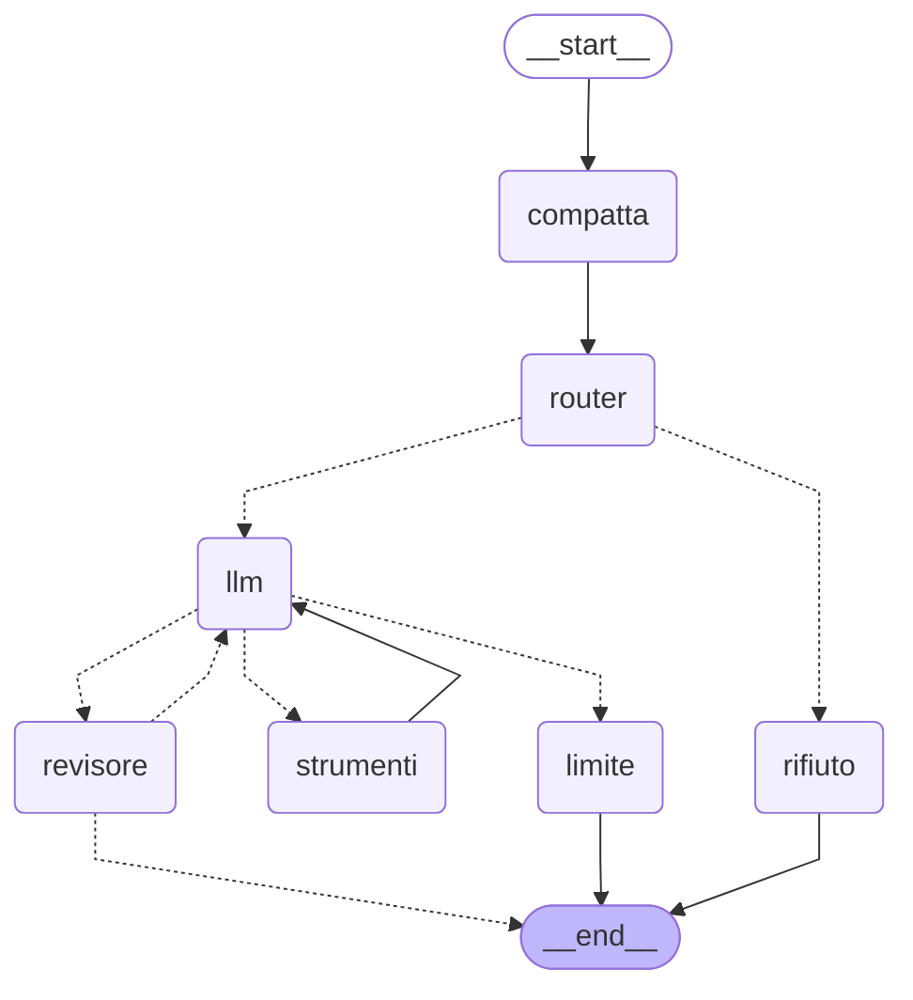

# Come funziona l'assistente

## Che cosa è stato fatto

- Una chat da terminale (`python -m agente`) che conversa con un modello locale servito da LM Studio
  tramite la sua API compatibile con OpenAI.
- Il flusso è un **grafo LangGraph esplicito**: stato, nodi e instradamento sono scritti a mano in
  `agente/graph.py`, senza componenti prefabbricati (`create_react_agent`, `ToolNode`).
- Uno **strumento orologio**, `ora_corrente`, che il modello richiede con il tool calling e che il
  programma esegue davvero. L'output indica sempre il fuso orario.
- Una **cronologia di sessione** tenuta dal client in una lista: si perde all'uscita. Quando diventa
  lunga, il nodo `compatta` fa riassumere al modello i messaggi vecchi.
- Sei **server MCP** (lezione 5), `meteo`, `note`, `unita`, `calcolatrice`, `scadenze` e `catalogo`,
  avviati come sottoprocessi: i loro strumenti (`meteo_attuale`, `previsioni_meteo`, `aggiungi_nota`,
  `elenca_note`, `elimina_nota`, `converti_unita`, `calcola`, `giorni_tra`, `aggiungi_giorni`,
  `cerca_corsi`, `dettaglio_corso`) vengono scoperti dal catalogo e usati dal grafo come l'orologio. Le note sono salvate in SQLite e
  **persistono**; la cronologia della chat no.
- Avvio anche in **Docker Compose**, con LM Studio che resta sull'host.

## Che cosa fa l'agente, passo per passo

1. Il client legge la domanda (`Tu> ...`) e invoca il grafo con la cronologia più la nuova domanda.
2. Il nodo `compatta` controlla la lunghezza della cronologia: oltre `MAX_MESSAGGI_CONTESTO` messaggi
   fa riassumere al modello quelli vecchi, tiene gli ultimi `MESSAGGI_DA_TENERE` e scrive il riassunto
   nel campo `riassunto` dello stato.
3. Il nodo `router` chiede al modello (senza strumenti, con output strutturato) se la domanda rientra
   nell'ambito `AMBITO_AGENTE`. Se è `fuori_ambito`, il nodo `rifiuto` aggiunge un messaggio fisso e il
   turno finisce senza passare dall'agente; se è `conversazione` si prosegue.
4. Il nodo `llm` manda al modello il prompt di sistema (con l'eventuale riassunto) e gli ultimi
   messaggi della cronologia.
5. Se il modello risponde con del testo, il nodo `revisore` chiede al modello (senza strumenti, con
   output strutturato) se la risposta tratta tutte le parti della domanda. Se sì, o se si è già al
   limite `MAX_REVISIONI`, il turno finisce e il client stampa `Assistente> ...`; altrimenti una nota
   del revisore con il motivo entra nella cronologia e si torna al nodo `llm`.
6. Se il modello chiede uno strumento (una *tool_call*), il nodo `strumenti` lo esegue e aggiunge il
   risultato alla cronologia; poi si torna al nodo `llm`, che ora vede l'ora vera e risponde.
7. Se il modello continua a chiedere strumenti oltre `MAX_PASSI_STRUMENTO` volte, il nodo `limite`
   chiude il turno con un messaggio di scuse.
8. Il client salva la cronologia (già compattata) e il riassunto restituiti dal grafo e ripropone il prompt.

## Moduli

```
main.py ──► config.py        variabili d'ambiente → Config (errori chiari, uscita 1)
   │──────► llm.py           ChatOpenAI verso LM Studio (con strumenti e riassuntore senza) + verifica
   │──────► strumenti.py     strumento ora_corrente
   │──────► preferenze.py    legge la resource utente://preferenze (una volta, all'avvio)
   │──────► comandi.py       /prompts e /prompt: prompt MCP richiamati dall'utente
   │──────► mcp_ponte.py     avvia i server MCP e ne espone il catalogo come tool sincroni; legge le resource
   │──────► graph.py         stato, nodi, instradamento, compattazione, finestra di contesto
   └──────► client.py        ciclo della chat e cronologia
```

- `graph.py` non importa `llm.py`: modello e strumenti gli arrivano da fuori. Così i test usano un
  modello finto, e nelle prossime lezioni si potranno aggiungere strumenti senza toccare il grafo.
- I server MCP (`server_mcp/meteo.py`, `server_mcp/note.py` e gli altri) sono **programmi a parte**, non moduli
  dell'agente: l'agente li avvia con `python -m server_mcp.meteo` e ci parla via stdin/stdout.
- `client.py` non sa nulla di LM Studio: conosce solo il grafo compilato e gli errori
  `openai.APIError` e `GraphRecursionError`, che trasforma in messaggi leggibili.

## Schema del grafo

```
                                                   ┌────────────────────────────────────────────┐
                                                   ▼                                            │
START ─► compatta ─► router ─► instrada_dopo_router ─► llm ─► instrada_dopo_llm ─┬─ nessuna tool_call ─► revisore ─► instrada_dopo_revisore ─┬─ coerente o limite ─► END
                                    │ (conversazione)            ▲               ├─ tool_call e passi < MAX ─► strumenti                   │
                                    │                            │               └─ tool_call e passi ≥ MAX ─► limite ─► END                │
                                    │                            └────────────────────────────────── nota del revisore (non coerente) ─────┘
                                    └─ fuori_ambito ─► rifiuto ─► END
```

Lo stesso grafo in Mermaid, generato dal codice con `get_graph().draw_mermaid()` (le frecce
tratteggiate sono gli archi condizionali):



Per rigenerarlo (con una lambda al posto del modello: per disegnare il grafo non serve LM Studio):

```powershell
python -c "from langchain_core.runnables import RunnableLambda; from agente.graph import costruisci_grafo; from agente.strumenti import crea_ora_corrente; g = costruisci_grafo(RunnableLambda(lambda m: m), [crea_ora_corrente()], max_passi=3, max_messaggi_contesto=20, fuso_predefinito='Europe/Rome', riassuntore=RunnableLambda(lambda m: m), router=RunnableLambda(lambda m: m), ambito='x', revisore=RunnableLambda(lambda m: m)); print(g.get_graph().draw_mermaid())"
```

## Stato

```python
class AgentState(TypedDict):
    messages: Annotated[list[AnyMessage], add_messages]  # cronologia (Human/AI/Tool)
    passi_strumento: int                                   # giri di strumento nel turno corrente
    categoria: str                                         # decisione del router per il turno corrente
    revisioni: int                                         # revisioni chieste dal revisore nel turno
    riassunto: str                                         # riassunto dei messaggi vecchi (step 3)
```

- `messages` usa il reducer `add_messages`: ogni nodo restituisce solo i messaggi **nuovi**, che
  vengono accodati.
- `passi_strumento` non ha reducer: il valore restituito sostituisce il precedente. Il client lo
  riparte da 0 a ogni domanda.
- `categoria` non ha reducer: la scrive il nodo `router` a ogni turno (`conversazione` o `fuori_ambito`).
- `riassunto` non ha reducer: lo scrive `compatta`, e il nuovo sostituisce il vecchio (che il
  riassuntore ha già incorporato). Non sta in `messages`; il client lo conserva tra i turni.
- `revisioni` non ha reducer: la incrementa il nodo `revisore` quando rimanda la risposta all'agente;
  il client la riparte da 0 a ogni domanda.
- Il prompt di sistema **non** sta nello stato: il nodo `llm` lo mette in testa a ogni chiamata.

## Nodi e instradamento

| Nodo | Che cosa fa | Restituisce |
|---|---|---|
| `compatta` | se i messaggi sono più di `MAX_MESSAGGI_CONTESTO`, li divide in vecchi e recenti (`dividi_cronologia`, taglio su un `HumanMessage`), manda i vecchi come testo (`trascrivi`) (con l'eventuale riassunto precedente) al riassuntore senza strumenti, toglie i vecchi e scrive il campo `riassunto`; log INFO prima/dopo | `{}` oppure `{"messages": [RemoveMessage(REMOVE_ALL_MESSAGES), *recenti], "riassunto": nuovo}` |
| `router` | manda al router (stesso modello senza strumenti, `with_structured_output(DecisioneRouter)`) il prompt con l'ambito e la trascrizione degli ultimi 4 messaggi; log INFO con categoria, motivo e destinazione; errore o output non valido → WARNING e `conversazione`; senza router sempre `conversazione` | `{"categoria": "conversazione" \| "fuori_ambito"}` |
| `rifiuto` | aggiunge «Mi dispiace, posso aiutarti solo con: {ambito}.» senza chiamare il modello | `{"messages": [AIMessage]}` |
| `llm` | invia `[prompt di sistema + campo riassunto] + finestra_contesto(messages)` al modello, che ha già lo strumento collegato (`bind_tools`) | `{"messages": [AIMessage]}` |
| `strumenti` | esegue **ogni** tool_call dell'ultimo messaggio; scrive un log INFO per ciascuna; uno strumento sconosciuto, argomenti sbagliati o argomenti che non sono JSON valido (le `invalid_tool_calls` di LangChain) diventano un testo d'errore, non un'eccezione | `{"messages": [ToolMessage, ...], "passi_strumento": passi + 1}` |
| `limite` | risponde «Non eseguito» a ogni tool_call rimasta in sospeso (altrimenti la cronologia non sarebbe valida per l'API) e aggiunge il messaggio per l'utente; log WARNING | `{"messages": [ToolMessage, ..., AIMessage]}` |
| `revisore` | manda al revisore (stesso modello senza strumenti, `with_structured_output(DecisioneRevisore)`) `PROMPT_REVISORE` e un messaggio con la domanda del turno e la risposta proposta; log INFO con giudizio, motivo e destinazione; se non coerente e sotto `MAX_REVISIONI` aggiunge la nota del revisore (`HumanMessage` di nome `revisore`, non un `SystemMessage`: alcuni modelli ne accettano uno solo, in testa); al limite WARNING; errore o output non valido → WARNING e risposta accettata | `{}` oppure `{"messages": [HumanMessage], "revisioni": revisioni + 1}` |

Le tool_call con argomenti non JSON contano come tool_call: l'API le rimanda al modello, quindi
devono ricevere anch'esse un `ToolMessage`, altrimenti la cronologia non sarebbe più valida.

`instrada_dopo_router(stato)`: `fuori_ambito` → `rifiuto`, altrimenti → `llm`.

`instrada_dopo_llm(stato, max_passi)` è una funzione pura: nessuna tool_call → `revisore`; tool_call con
`passi_strumento < max_passi` → `strumenti`; altrimenti → `limite`.

`instrada_dopo_revisore(stato)`: ultimo messaggio nota del revisore → `llm`, altrimenti → `END`.

Come rete di sicurezza il client passa a `invoke()` un `recursion_limit` di
`2 * MAX_PASSI_STRUMENTO + 2 * MAX_REVISIONI + 6`. Con i nodi `limite` e `revisore` non dovrebbe mai
scattare; se scatta, il client mostra un errore leggibile.

## Lo strumento `ora_corrente`

- Firma vista dal modello: `ora_corrente(fuso_orario: str = "Europe/Rome")`. Il fuso predefinito
  viene da `FUSO_ORARIO_PREDEFINITO` ed è scritto sia nella descrizione sia nel default.
- Il fuso è un nome IANA, validato con `zoneinfo`. Il database dei fusi arriva dal pacchetto `tzdata`,
  perché né Windows né l'immagine `python:3.13-slim` lo includono.
- L'output è sempre esplicito sul fuso, anche quando si usa il predefinito:

  ```
  Fuso orario: Europe/Rome (CET, UTC+01:00)
  Data: martedì 3 novembre 2026
  Ora: 12:47:57
  ISO 8601: 2026-11-03T12:47:57+01:00
  ```
- Giorni e mesi in italiano vengono da tabelle nel codice, non dal `locale` di sistema.
- Con un fuso non valido (es. `"Roma"`) lo strumento restituisce al modello un messaggio d'errore e
  scrive un WARNING; il modello può riprovare entro il limite di passaggi.
- La logica pura è `descrivi_ora(fuso, adesso)` in `servizio_orologio/logica.py` (solleva
  `FusoNonValido`); `calcola_ora` dell'agente la avvolge e restituisce il testo `Errore: …`.
  I test le passano un istante fisso.
- Lo stesso strumento esiste in tre varianti (`VARIANTE_OROLOGIO`): funzione locale, servizio FastAPI
  con wrapper HTTP scritto a mano, server FastMCP. Tabella in `docs/GRAFO_E_STRUMENTI.md`.

Nelle prove reali `google/gemma-4-e2b` chiama `ora_corrente` con `{}` per «Che ore sono?» (quindi
vale il default `Europe/Rome`) e con `{'fuso_orario': 'Asia/Tokyo'}` per «E a Tokyo?».

## Strumenti MCP: host, client e server

MCP (Model Context Protocol) è un protocollo per offrire strumenti a un modello senza scriverli
dentro l'agente. Tre ruoli:

| Ruolo | Chi è qui | Che cosa fa |
|---|---|---|
| **host** | l'applicazione `python -m agente` (grafo + modello) | decide quali server usare e porta le richieste del modello |
| **client** | l'oggetto `fastmcp.Client` dentro `agente/mcp_ponte.py` | una sessione con **un** server: chiede il catalogo, invia le chiamate |
| **server** | `server_mcp/*.py` (sei server) | processi separati che dichiarano i tool e li eseguono |

Il trasporto predefinito è **stdio** (con `TRASPORTO_MCP=http` si usa invece Streamable HTTP: vedi
sotto «Stdio o Streamable HTTP»): il client lancia il server come sottoprocesso (`sys.executable -m
server_mcp.meteo`, con `cwd` la cartella `lab_llm/`) e scambia messaggi JSON-RPC su stdin/stdout. Per
questo i server non scrivono mai su stdout (sarebbe corrompere il protocollo): i loro log vanno su
stderr.

### Il percorso di uno strumento

```
avvio      tools/list  ──► catalogo (nome, descrizione, schema JSON dei parametri)
                          └► un StructuredTool LangChain per voce, con schema = quello del server
costruzione  bind_tools(strumenti) ──► il modello conosce nome, descrizione e schema
domanda      il modello risponde con una tool_call {name, args, id}
esecuzione   nodo strumenti ──► tool.invoke(args) ──► tools/call (JSON-RPC) ──► il server esegue
risposta     testo del risultato ──► ToolMessage(content=testo, tool_call_id=id) ──► torna al nodo llm
```

- `tools/list` è la **discovery**: nome, descrizione e schema dei tool arrivano **solo** dal server
  (`list_tools()`), mai scritti nell'agente. Aggiungere un tool a un server lo rende disponibile
  senza toccare il grafo.
- `langchain-mcp-adapters`, che fa questo lavoro, **non è usato**: richiede `mcp<2`, incompatibile
  con `mcp==2.3.0` (richiesta da `fastmcp==4.1.6`). Il piccolo adattatore è `ConnessioneMCP._crea_strumento`.
- Lo schema è passato a LangChain come dizionario JSON e **non viene validato** lì: gli argomenti
  scelti dal modello arrivano al server, che li valida. Un argomento sbagliato diventa un testo
  d'errore, non un'eccezione che rompe il turno.
- Il nodo `strumenti` del grafo non sa che un tool è MCP: lo invoca come l'orologio. L'unica
  differenza visibile è `origine=mcp:<server>` nel log (nel campo `metadata` del tool).

### Stdio o Streamable HTTP
Il trasporto decide come viaggiano i messaggi, non che cosa dicono. `server_mcp/avvio.py` fa partire
ogni server con `MCP_TRASPORTO` (`stdio` o `http`); con HTTP il server ascolta su
`http://127.0.0.1:<porta>/mcp` ed è avviato a parte (`python -m server_mcp.avvia_http`). Nell'agente
`TRASPORTO_MCP=http` dà a ogni `ServerMCP` un `url`, e `crea_trasporto` sceglie
`StreamableHttpTransport` invece di `StdioTransport`. Catalogo, tool sincroni ed esiti restano
identici (verificato da `tests/test_mcp_http.py`). Cambia la diagnosi: con stdio si controllano
interprete, percorsi e stdout pulito; con HTTP URL, porta, processo in ascolto e timeout.

### `tool_call_id` e ID JSON-RPC

Sono due identificativi diversi, su due «cavi» diversi:

| | `tool_call_id` | ID JSON-RPC |
|---|---|---|
| tra chi | modello ↔ cronologia della conversazione | client ↔ server MCP |
| chi lo crea | il modello (in LM Studio) | la libreria client, a ogni richiesta |
| a che serve | abbinare il `ToolMessage` alla `tool_call` che risponde | abbinare la risposta JSON-RPC alla sua richiesta |
| dove si vede | nei log (`call_id=...`) | non si vede: lo gestisce la libreria |

Il server MCP non conosce mai il `tool_call_id`, e il modello non vede mai l'ID JSON-RPC.

### Perché il ponte ha un thread

Il grafo e il client della chat sono **sincroni**; la libreria MCP è **asincrona** e una sessione con un
server deve restare aperta per tutta la chat (riavviare un sottoprocesso a ogni domanda sarebbe lento
e perderebbe lo stato). `ConnessioneMCP` risolve così:

1. all'ingresso (`with ConnessioneMCP(...)`) crea un **event loop asyncio** e lo fa girare in un
   **thread dedicato** (`ponte-mcp`), l'unico posto del programma con `asyncio`;
2. per ogni server, una coroutine «custode» apre la sessione, legge il catalogo e poi aspetta un
   evento di chiusura: la sessione si apre e si chiude nello stesso task, come richiede `anyio`;
3. ogni tool sincrono invia `call_tool` al loop con `run_coroutine_threadsafe` e attende l'esito
   (`futuro.result(timeout)`): per il grafo è una normale chiamata bloccante;
4. all'uscita segnala la chiusura ai custodi, attende che i sottoprocessi terminino, ferma il loop e
   unisce il thread.

### I tre esiti che il modello legge

| Situazione | Testo nel `ToolMessage` | Livello del log |
|---|---|---|
| successo | il testo restituito dal server | INFO, `esito=ok` |
| il server ha rifiutato la richiesta (`ToolError`: argomenti non validi, ID inesistente, città non trovata) | `Errore dallo strumento <nome>: <messaggio>` | WARNING + INFO `esito=errore` |
| il collegamento è fallito (timeout, processo morto) | `Errore di collegamento MCP con il server <server>: <dettaglio>` | WARNING + INFO `esito=errore` |

Distinguerli serve a capire dove cercare: nel secondo caso il server funziona e la richiesta era
sbagliata; nel terzo è il collegamento a non funzionare.

Se un server non parte o non risponde al catalogo entro `MCP_TIMEOUT`, `ConnessioneMCP` scrive un
WARNING e **prosegue**: gli altri strumenti restano disponibili e la chat si avvia. Anche per i
timeout vale `MCP_TIMEOUT` (per il server meteo, `METEO_TIMEOUT` vale per ogni richiesta HTTP).
La variabile `FASTMCP_LOG_LEVEL=WARNING`, passata ai sottoprocessi, tace il banner del framework.

### I server

- **meteo** (`server_mcp/meteo.py`): `meteo_attuale(citta)` e `previsioni_meteo(citta, giorni=3)`,
  1–7 giorni. Chiama l'API di geocoding e poi quella delle previsioni di Open-Meteo (con `httpx`);
  indica sempre la località scelta (regione e paese, se noti), elenca le alternative con lo stesso
  nome, scrive «n.d.» per i valori mancanti e traduce i codici WMO in italiano.
- **note** (`server_mcp/note.py`): `aggiungi_nota(testo)`, `elenca_note(limite=10)`,
  `elimina_nota(id_nota)`. Archivio SQLite nel file `NOTE_DB`; query parametrizzate (un testo come
  `l'esame; DROP TABLE note` viene salvato letteralmente). `aggiungi_nota` ed `elimina_nota` modificano
  i dati e lo dichiarano nella loro descrizione.
- In entrambi la logica sta in funzioni e classi che non dipendono da MCP (`testo_meteo_attuale`,
  `ArchivioNote`), così si testano senza avviare nulla; il decoratore `@mcp.tool` le espone soltanto.
- **unita** (`server_mcp/unita.py`): `converti_unita(valore, da, a)` su un elenco chiuso di unità per
  grandezza (lunghezza, massa, volume, velocità, temperatura), con simboli o nomi italiani. Errore per
  unità sconosciuta (con l'elenco delle ammesse), grandezze diverse e temperature sotto lo zero assoluto.
- **calcolatrice** (`server_mcp/calcolatrice.py`): `calcola(espressione)`. L'espressione viene letta con
  `ast.parse` e visitata nodo per nodo: passano solo numeri, `+ - * / // % **` e parentesi; nomi,
  chiamate, attributi e confronti vengono rifiutati con un messaggio che dice quale elemento non va.
  Limiti su lunghezza, esponente e grandezza del risultato. **Mai `eval`.**
- **scadenze** (`server_mcp/scadenze.py`): `giorni_tra(data_inizio, data_fine)` e
  `aggiungi_giorni(data, giorni, solo_lavorativi=False)`, date `AAAA-MM-GG` o `oggi` (calcolato nel fuso
  `FUSO_ORARIO_PREDEFINITO`, che `main.py` passa al server come `FUSO_ORARIO`: così concorda con l'orologio). Fine settimana e
  festività (`server_mcp/risorse/festivita.json`: fisse e Lunedì dell'Angelo 2024–2030) non sono
  lavorativi; se un anno non ha le festività mobili nel file, il risultato lo dice. Risultato «non normativo».
- **catalogo** (`server_mcp/catalogo.py`): due tool sullo stesso file `server_mcp/risorse/corsi.json`
  (corsi inventati): `cerca_corsi(testo, max_risultati=5)` cerca tutte le parole in codice, titolo, sede e
  descrizione, ignorando parole come «corsi», «a», «di» che il modello copia dalla domanda;
  `dettaglio_corso(codice)` dà tutti i campi. Nessun risultato = lista vuota dichiarata.

### Che cosa fa il prompt di sistema

Con un modello piccolo la descrizione del tool non basta: `PROMPT_SISTEMA` dice di usare
`meteo_attuale` e `previsioni_meteo` per il meteo, di **chiamare** `aggiungi_nota` quando l'utente
chiede di ricordare qualcosa e di non dire mai «salvata» se lo strumento non l'ha confermato, e di
riferire gli errori senza inventare risultati. Senza quella riga `google/gemma-4-e2b` rispondeva
«Ho salvato la nota» senza chiamare nulla.

Alcune istruzioni valgono solo se lo strumento è collegato: stanno in `ISTRUZIONI_PER_STRUMENTO` e
`costruisci_grafo` le aggiunge al prompt solo per gli strumenti presenti. Oggi c'è quella di `calcola`
(«per» e «x» = moltiplicazione, «diviso» = divisione): senza, gemma-4-e2b traduceva «15 per 12» in
`15/12`, e la descrizione del tool non bastava. Messa fissa nel prompt, però, rompeva l'orologio quando
`calcola` non era collegato (4 su 4 «Che ore sono?» senza chiamata a `ora_corrente`): citare uno
strumento assente confonde il modello.

## Preferenze dell'utente: la resource `utente://preferenze`

| Primitiva | Chi la attiva | Quando | Nei log |
|---|---|---|---|
| tool | il modello | durante il ciclo | `strumento=… origine=mcp:… esito=…` a ogni chiamata |
| resource | l'host (`main.py`) | una volta, prima di avviare gli altri server e della prima domanda | `resource: utente://preferenze letta dal server utente: …` |
| prompt | l'utente (`/prompt`) | solo quando lo richiama; `prompts/list` una volta all'avvio della chat | `prompt: richiamato … argomenti=… dal server utente: N messaggi` |

- Il server `utente` (`server_mcp/utente.py`) non ha tool: espone solo la resource, che restituisce il
  file `PREFERENZE_FILE` (riletto a ogni richiesta). Esempio:
  `{"lingua": "italiano", "fuso_orario": "Europe/Rome", "stile": "sintetico"}`.
- `leggi_preferenze` apre una connessione MCP con il solo server `utente`, chiama
  `ConnessioneMCP.leggi_risorsa` (`resources/read`) e chiude. È separata dalla connessione dei tool perché
  il fuso delle preferenze serve **prima** di avviare l'orologio e `scadenze` (che lo ricevono in
  `FUSO_ORARIO`).
- `interpreta` controlla ogni campo: lingua non vuota, fuso IANA esistente, stile `sintetico` o
  `dettagliato`. Un campo non valido torna al predefinito (WARNING `preferenze: stile='poetico' non
  valido, …`); server spento, file mancante o JSON non valido → tutti i predefiniti (WARNING
  `preferenze: resource utente://preferenze non disponibile, uso i valori predefiniti (…): …`).
- `main.py` sostituisce `fuso_orario_predefinito` nella `Config` della sessione e passa al grafo
  `preferenze=istruzioni(...)`, che completa la prima riga del prompt di sistema:
  `Sei l'assistente del laboratorio. Rispondi sempre in italiano, in modo breve e chiaro.` La forma è
  volutamente asciutta. Sonde reali del 2026-11-14 (3 tentativi per variante): con l'URI della resource, lo stile tra
  parentesi e il fuso nella riga gemma-4-e2b inventava l'ora (0 chiamate a `ora_corrente` su 3); con
  l'etichetta «Preferenze dell'utente:» o con le preferenze prima di «Sei l'assistente del
  laboratorio.» non chiamava `calcola` per «15 per 12» (0 su 3), e lo stesso togliendo «(ora
  italiana)». Con la forma attuale 3 su 3. «(ora italiana)» resta solo con `Europe/Rome`.

## Prompt MCP: `/prompts` e `/prompt` (step 5)

- `agente/comandi.py`, `ComandiPrompt(connessione)`: all'avvio della chat `elenca_prompt("utente")`
  (`prompts/list`), log `prompt: catalogo del server utente [spiega, riassumi_conversazione]`.
- Nel client le righe che iniziano con `/` non vanno mai al modello come testo: `/prompts` stampa
  l'elenco, `/prompt …` passa da `ComandiPrompt.richiama`, ogni altro comando è «sconosciuto».
- `richiama` divide la riga con `shlex` (virgolette per i valori con spazi) e la controlla rispetto al
  catalogo: prompt sconosciuto, argomento sconosciuto, argomento obbligatorio mancante, token senza `=`,
  virgolette non chiuse → `ErroreComando`, stampato come `Assistente> [errore] …`, **senza** chiamare
  server o modello. Un errore del server (es. `livello=esperto`) diventa anch'esso `ErroreComando`.
- Se valida: `ottieni_prompt` (`prompts/get`) restituisce i messaggi (ruolo, testo); `user` diventa
  `HumanMessage`, `assistant` `AIMessage`; `rispondi(..., nuovi=messaggi)` li mette in coda alla
  cronologia al posto della domanda. Log `prompt: richiamato …` e una riga `prompt: messaggio i (ruolo): …`.

## Compattazione della cronologia (nodo `compatta`)

- Scatta all'inizio del turno quando la cronologia supera `MAX_MESSAGGI_CONTESTO` (default 20).
- Restano gli ultimi `MESSAGGI_DA_TENERE` messaggi (default 6), con l'inizio spostato in avanti fino
  a un `HumanMessage`: una tool_call non viene mai separata dalla sua risposta.
- I messaggi vecchi diventano un testo semplice (`Utente: ...`, `Assistente: ...`, `Strumento: ...`,
  `Revisore: ...`), preceduto da `Riassunto precedente: ...` se c'è, e vanno a un **riassuntore**: lo stesso modello ma **senza strumenti**
  (`crea_riassuntore`), così non può chiedere l'ora invece di riassumere.
- Dalla lezione 6 (step 3) il riassunto è il **campo `riassunto` dello stato**, non più un
  `SystemMessage` nella cronologia. Per togliere i messaggi vecchi il nodo restituisce
  `RemoveMessage(id=REMOVE_ALL_MESSAGES)` seguito dai messaggi da tenere: è il modo previsto da
  LangGraph per riscrivere una lista con `add_messages`.
- Alla compattazione successiva il riassunto vecchio entra nel testo da riassumere e il nuovo lo
  sostituisce: il campo viene aggiornato, non accumulato.
- Log INFO `riassunto: messaggi prima=9 dopo=3 (riassunti 6, tenuti 3)`; sotto la soglia nessuna
  chiamata al modello (log DEBUG `riassunto: 5 messaggi, sotto la soglia di 20, …`).
- Il nodo `llm` aggiunge il riassunto in coda al prompt di sistema: un solo messaggio di sistema in
  testa, perché alcuni modelli non ne accettano altri. Anche il router lo riceve: senza, dopo la
  compressione «Come mi chiamo?» veniva rifiutata come fuori ambito.
- Se LM Studio non risponde (`openai.APIError`) o il riassunto è vuoto: log WARNING, cronologia
  lasciata intera; resta la finestra scorrevole qui sotto.
- Prova reale: dopo cinque domande con soglia 6, `google/gemma-4-e2b` risponde ancora a «Come mi
  chiamo?» grazie al riassunto. Il prompt del riassunto chiede di scrivere «l'utente si chiama ...»:
  con un generico «Gabriele studia a Udine» il modello non capiva che si parlava di chi scrive.

## Contesto inviato al modello

- Al modello arrivano al massimo gli ultimi `MAX_MESSAGGI_CONTESTO` messaggi (default 20), tramite
  `finestra_contesto(messaggi, n)`. Con la compattazione attiva serve come rete di sicurezza.
- La finestra parte sempre da un `HumanMessage`: così non comincia mai con un `ToolMessage` orfano o
  con una tool_call senza risposta.
- Se l'ultimo turno da solo supera `n`, si tiene comunque tutto dall'ultimo `HumanMessage` in poi.
- Quando la finestra taglia qualcosa compare un log DEBUG («contesto: inviati 20 di 34 messaggi»):
  si vede con `LOG_LEVEL=DEBUG`.

## Log e print didattici

I log vanno su **stderr** (la chat su stdout), con il formato
`2026-11-03 12:47:57 INFO  agente.graph | ...`. Il livello viene da `LOG_LEVEL`. Le librerie HTTP
(`httpx`, `httpx2`, `httpcore`, `openai`) sono forzate a WARNING, altrimenti ogni richiesta verrebbe
stampata.

| Evento | Livello | Esempio |
|---|---|---|
| avvio | INFO | `avvio: modello=google/gemma-4-e2b server=http://localhost:1234/v1 max_passi=3 contesto=20 da_tenere=6 max_revisioni=2` |
| decisione del router | INFO | `router: categoria=fuori_ambito motivo=La domanda non riguarda data, ora, meteo o note personali. -> rifiuto` |
| agente eseguito (assente se la domanda è rifiutata) | INFO | `agente: invio 2 messaggi al modello` |
| router non riuscito | WARNING | `router non riuscito, domanda passata all'agente: Connection error.` |
| resource letta all'avvio | INFO | `resource: utente://preferenze letta dal server utente: lingua=italiano fuso_orario=America/New_York stile=sintetico` |
| resource non disponibile o campo non valido | WARNING | `preferenze: resource utente://preferenze non disponibile, uso i valori predefiniti (lingua=italiano fuso_orario=Europe/Rome stile=sintetico): …` |
| catalogo dei prompt | INFO | `prompt: catalogo del server utente [spiega, riassumi_conversazione]` |
| prompt richiamato | INFO | `prompt: richiamato spiega argomenti={"argomento": "Model Context Protocol", "livello": "base"} dal server utente: 1 messaggi` |
| giudizio del revisore | INFO | `revisore: coerente=no motivo=La risposta tratta solo l'ora a Tokyo e ignora il calcolo. -> agente (revisione 1 di 2)` |
| limite di revisioni | WARNING | `revisore: limite di 2 revisioni raggiunto, restituita l'ultima risposta` |
| revisore non riuscito | WARNING | `revisore non riuscito, risposta accettata: Connection error.` |
| cronologia compattata | INFO | `riassunto: messaggi prima=21 dopo=5 (riassunti 16, tenuti 5)` |
| riassunto non riuscito | WARNING | `riassunto non riuscito, cronologia lasciata intera: Connection error.` |
| chiamata a uno strumento | INFO | `strumento=ora_corrente origine=locale call_id=... argomenti={"fuso_orario": "Asia/Tokyo"} esito=ok risultato=Fuso orario: Asia/Tokyo ...` |
| chiamata a un tool MCP | INFO | `strumento=meteo_attuale origine=mcp:meteo call_id=... argomenti={"citta": "Udine"} esito=ok risultato=...` |
| catalogo di un server MCP | INFO | `server MCP meteo: catalogo [meteo_attuale, previsioni_meteo]` |
| server MCP non disponibile, errore di collegamento | WARNING | `server MCP meteo non disponibile: ...` |
| fuso non valido, strumento sconosciuto | WARNING | `strumento ora_corrente: fuso 'Roma' non riconosciuto` |
| limite raggiunto | WARNING | `limite di 3 passaggi raggiunto: 1 tool_call non eseguite` |
| finestra di contesto applicata | DEBUG | `contesto: inviati 20 di 34 messaggi` |
| errore di collegamento | ERROR | `LM Studio non raggiungibile su ...: Connection error.` |

Nel codice ci sono anche dei **print didattici** `# print("[passo] ...")`, all'ingresso di ogni nodo,
a ogni decisione di instradamento, prima di ogni chiamata al modello e a ogni turno del client. Sono
commentati per non sporcare la chat: per seguire il flusso passo per passo basta togliere il `#`.
