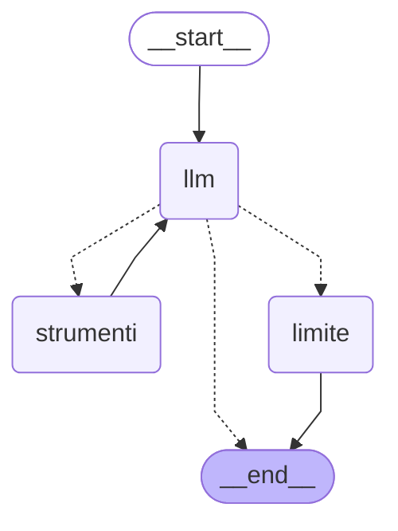

# Come funziona l'assistente

## Che cosa è stato fatto

- Una chat da terminale (`python -m agente`) che conversa con un modello locale servito da LM Studio
  tramite la sua API compatibile con OpenAI.
- Il flusso è un **grafo LangGraph esplicito**: stato, nodi e instradamento sono scritti a mano in
  `agente/graph.py`, senza componenti prefabbricati (`create_react_agent`, `ToolNode`).
- Uno **strumento orologio**, `ora_corrente`, che il modello richiede con il tool calling e che il
  programma esegue davvero. L'output indica sempre il fuso orario.
- Una **cronologia di sessione** tenuta dal client in una lista: si perde all'uscita.
- Avvio anche in **Docker Compose**, con LM Studio che resta sull'host.

## Che cosa fa l'agente, passo per passo

1. Il client legge la domanda (`Tu> ...`) e invoca il grafo con la cronologia più la nuova domanda.
2. Il nodo `llm` manda al modello il prompt di sistema e gli ultimi messaggi della cronologia.
3. Se il modello risponde con del testo, il turno finisce e il client stampa `Assistente> ...`.
4. Se il modello chiede uno strumento (una *tool_call*), il nodo `strumenti` lo esegue e aggiunge il
   risultato alla cronologia; poi si torna al nodo `llm`, che ora vede l'ora vera e risponde.
5. Se il modello continua a chiedere strumenti oltre `MAX_PASSI_STRUMENTO` volte, il nodo `limite`
   chiude il turno con un messaggio di scuse.
6. Il client salva la cronologia restituita dal grafo e ripropone il prompt.

## Moduli

```
main.py ──► config.py        variabili d'ambiente → Config (errori chiari, uscita 1)
   │──────► llm.py           ChatOpenAI verso LM Studio + verifica del modello all'avvio
   │──────► strumenti.py     strumento ora_corrente
   │──────► graph.py         stato, nodi, instradamento, finestra di contesto
   └──────► client.py        ciclo della chat e cronologia
```

- `graph.py` non importa `llm.py`: modello e strumenti gli arrivano da fuori. Così i test usano un
  modello finto, e nelle prossime lezioni si potranno aggiungere strumenti senza toccare il grafo.
- `client.py` non sa nulla di LM Studio: conosce solo il grafo compilato e gli errori
  `openai.APIError` e `GraphRecursionError`, che trasforma in messaggi leggibili.

## Schema del grafo

```
          ┌────────────────────────────────────────────┐
          ▼                                            │
START ─► llm ─► instrada_dopo_llm ─┬─ nessuna tool_call ──────────► END
                                   ├─ tool_call e passi < MAX ─► strumenti
                                   └─ tool_call e passi ≥ MAX ─► limite ─► END
```

Lo stesso grafo in Mermaid, generato dal codice con `get_graph().draw_mermaid()` (le frecce
tratteggiate sono gli archi condizionali):



Per rigenerarlo (con una lambda al posto del modello: per disegnare il grafo non serve LM Studio):

```powershell
python -c "from langchain_core.runnables import RunnableLambda; from agente.graph import costruisci_grafo; from agente.strumenti import crea_ora_corrente; g = costruisci_grafo(RunnableLambda(lambda m: m), [crea_ora_corrente()], max_passi=3, max_messaggi_contesto=20, fuso_predefinito='Europe/Rome'); print(g.get_graph().draw_mermaid())"
```

## Stato

```python
class AgentState(TypedDict):
    messages: Annotated[list[AnyMessage], add_messages]  # cronologia (Human/AI/Tool)
    passi_strumento: int                                   # giri di strumento nel turno corrente
```

- `messages` usa il reducer `add_messages`: ogni nodo restituisce solo i messaggi **nuovi**, che
  vengono accodati.
- `passi_strumento` non ha reducer: il valore restituito sostituisce il precedente. Il client lo
  riparte da 0 a ogni domanda.
- Il prompt di sistema **non** sta nello stato: il nodo `llm` lo mette in testa a ogni chiamata.

## Nodi e instradamento

| Nodo | Che cosa fa | Restituisce |
|---|---|---|
| `llm` | invia `[prompt di sistema] + finestra_contesto(messages)` al modello, che ha già lo strumento collegato (`bind_tools`) | `{"messages": [AIMessage]}` |
| `strumenti` | esegue **ogni** tool_call dell'ultimo messaggio; scrive un log INFO per ciascuna; uno strumento sconosciuto o argomenti sbagliati diventano un testo d'errore, non un'eccezione | `{"messages": [ToolMessage, ...], "passi_strumento": passi + 1}` |
| `limite` | risponde «Non eseguito» a ogni tool_call rimasta in sospeso (altrimenti la cronologia non sarebbe valida per l'API) e aggiunge il messaggio per l'utente; log WARNING | `{"messages": [ToolMessage, ..., AIMessage]}` |

`instrada_dopo_llm(stato, max_passi)` è una funzione pura: nessuna tool_call → `END`; tool_call con
`passi_strumento < max_passi` → `strumenti`; altrimenti → `limite`.

Come rete di sicurezza il client passa a `invoke()` un `recursion_limit` di `2 * MAX_PASSI_STRUMENTO + 5`.
Con il nodo `limite` non dovrebbe mai scattare; se scatta, il client mostra un errore leggibile.

## Lo strumento `ora_corrente`

- Firma vista dal modello: `ora_corrente(fuso_orario: str = "Europe/Rome")`. Il fuso predefinito
  viene da `FUSO_ORARIO_PREDEFINITO` ed è scritto sia nella descrizione sia nel default.
- Il fuso è un nome IANA, validato con `zoneinfo`. Il database dei fusi arriva dal pacchetto `tzdata`,
  perché né Windows né l'immagine `python:3.13-slim` lo includono.
- L'output è sempre esplicito sul fuso, anche quando si usa il predefinito:

  ```
  Fuso orario: Europe/Rome (CET, UTC+01:00)
  Data: martedì 3 novembre 2026
  Ora: 12:47:57
  ISO 8601: 2026-11-03T12:47:57+01:00
  ```
- Giorni e mesi in italiano vengono da tabelle nel codice, non dal `locale` di sistema.
- Con un fuso non valido (es. `"Roma"`) lo strumento restituisce al modello un messaggio d'errore e
  scrive un WARNING; il modello può riprovare entro il limite di passaggi.
- La logica pura è `calcola_ora(fuso, adesso)`: i test le passano un istante fisso.

Nelle prove reali `google/gemma-4-e2b` chiama `ora_corrente` con `{}` per «Che ore sono?» (quindi
vale il default `Europe/Rome`) e con `{'fuso_orario': 'Asia/Tokyo'}` per «E a Tokyo?».

## Contesto inviato al modello

- Lo stato conserva tutta la cronologia; al modello arrivano solo gli ultimi `MAX_MESSAGGI_CONTESTO`
  messaggi (default 20), tramite `finestra_contesto(messaggi, n)`.
- La finestra parte sempre da un `HumanMessage`: così non comincia mai con un `ToolMessage` orfano o
  con una tool_call senza risposta.
- Se l'ultimo turno da solo supera `n`, si tiene comunque tutto dall'ultimo `HumanMessage` in poi.
- Quando la finestra taglia qualcosa compare un log DEBUG («contesto: inviati 20 di 34 messaggi»):
  si vede con `LOG_LEVEL=DEBUG`.

## Log e print didattici

I log vanno su **stderr** (la chat su stdout), con il formato
`2026-11-03 12:47:57 INFO  agente.graph | ...`. Il livello viene da `LOG_LEVEL`. Le librerie HTTP
(`httpx`, `httpx2`, `httpcore`, `openai`) sono forzate a WARNING, altrimenti ogni richiesta verrebbe
stampata.

| Evento | Livello | Esempio |
|---|---|---|
| avvio | INFO | `avvio: modello=google/gemma-4-e2b server=http://localhost:1234/v1 max_passi=3 contesto=20` |
| chiamata allo strumento | INFO | `strumento ora_corrente {'fuso_orario': 'Asia/Tokyo'} -> Fuso orario: Asia/Tokyo ...` |
| fuso non valido, strumento sconosciuto | WARNING | `strumento ora_corrente: fuso 'Roma' non riconosciuto` |
| limite raggiunto | WARNING | `limite di 3 passaggi raggiunto: 1 tool_call non eseguite` |
| finestra di contesto applicata | DEBUG | `contesto: inviati 20 di 34 messaggi` |
| errore di collegamento | ERROR | `LM Studio non raggiungibile su ...: Connection error.` |

Nel codice ci sono anche dei **print didattici** `# print("[passo] ...")`, all'ingresso di ogni nodo,
a ogni decisione di instradamento, prima di ogni chiamata al modello e a ogni turno del client. Sono
commentati per non sporcare la chat: per seguire il flusso passo per passo basta togliere il `#`.
